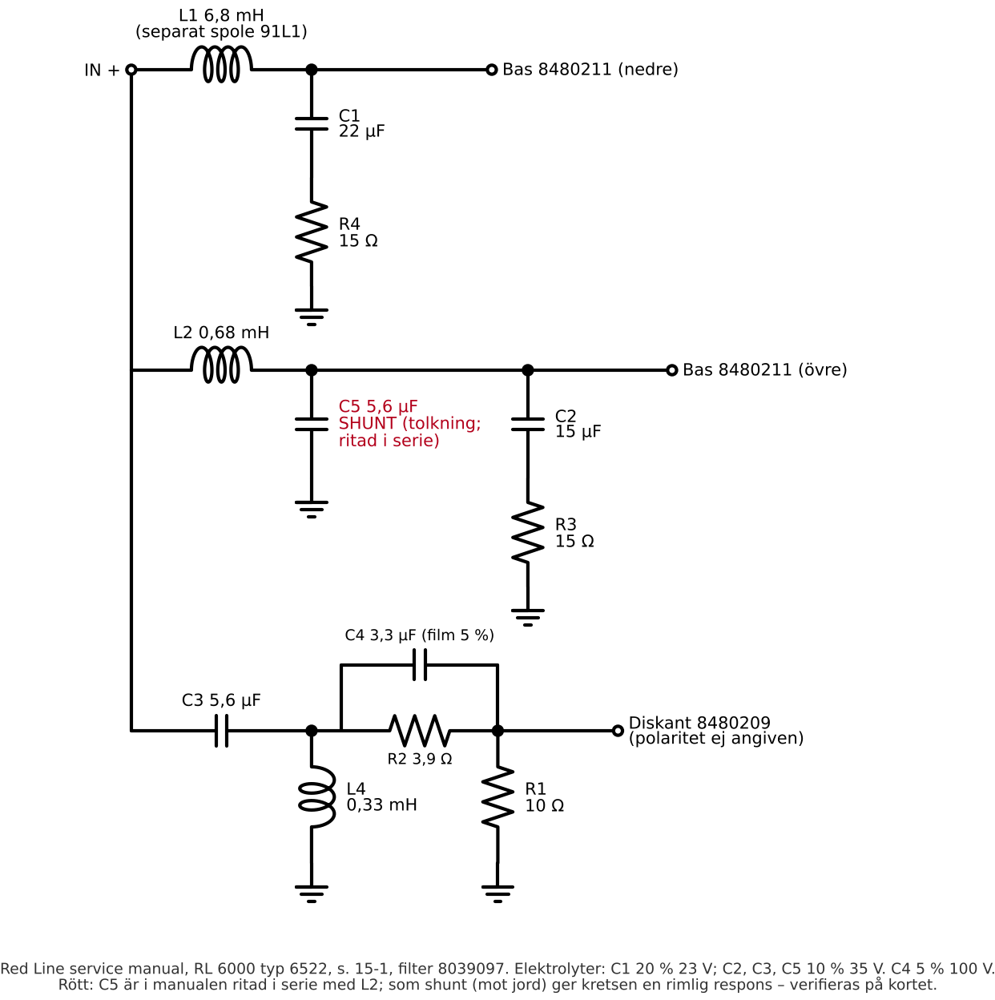
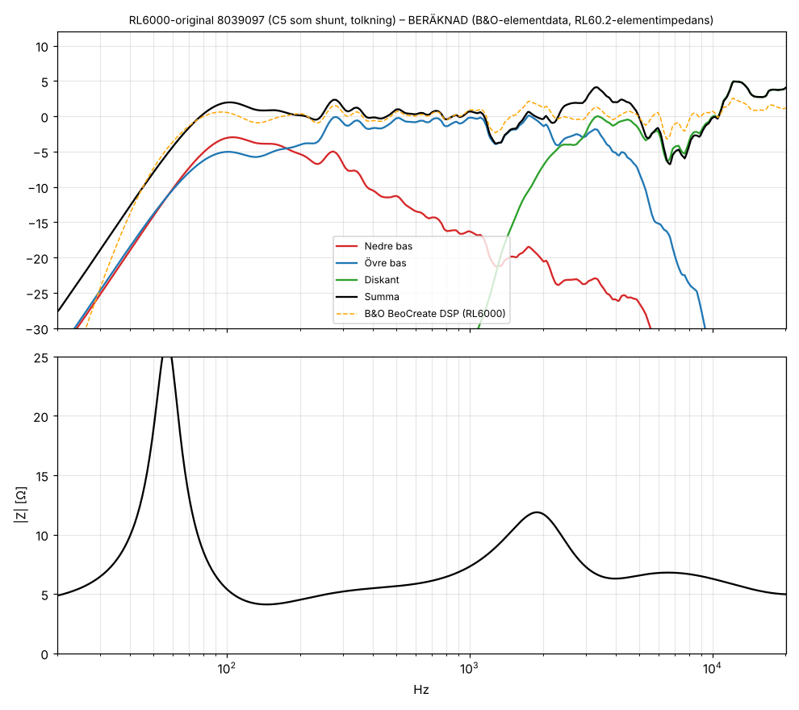
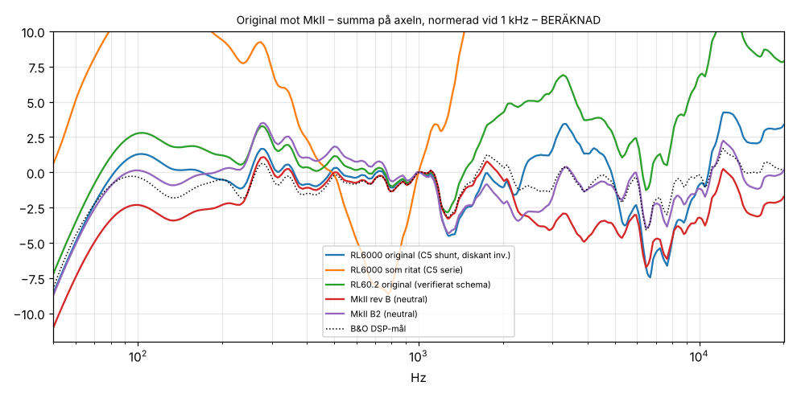

# Originalfiltren RL6000 och RL60.2 – verifierade scheman, analys och MkII-rekommendation

**RL6000 MkII · 2026-11-19 · rev 2 (RL6000-schemat verifierat)**

**Märkning:**
- **[V]** verifierat i B&O-dokument
- **[T]** tolkning med stark motivering, ska kontrolleras på kortet
- **[S]** simulerat (B&O:s elementdata för RL6000-element + RL60.2-elementimpedans)
- **[F]** forum eller sekundärkälla.

Kan reproduceras med `cd sim`:
- `python3 originals.py`: tabeller, figur 12–13, `spice/*.cir`
- `python3 hybrid_candidate.py`: hybridkandidaten
- `python3 schematic_originals.py`: figur 14–15.

---

## Sammanfattning

1. **Båda originalfiltren är nu avlästa ur B&O:s egna servicemanualer** [V]:
    - RL6000: Red Line Service Manual (RL1000/2000/6000/7000), s. 15-1, filter **8039097**, skannad i 600 dpi.
    - RL60.2: s. 1-15, filter 8039073.
2. **RL6000 är en 2,5-vägare med andra komponenter än RL60.2** [V]:
    - **Nya element:** baselement 8480211 (RL60.2: 8480177) och diskant **8480209** (RL60.2: 8480200).
    - **Nedre basen:** 6,8 mH + 22 µF/15 Ω.
    - **Övre basen:** 0,68 mH + 5,6 µF + 15 µF/15 Ω.
    - **Diskanten:** andra ordningens högpass (5,6 µF / 0,33 mH) och ett **L-pad** (3,9 Ω i serie, förbikopplad av 3,3 µF film, och 10 Ω shunt).
3. **Schemat innehåller troligen ett ritfel** [T]:
    - **C5 (5,6 µF) är ritad i serie** med övre basen. Det ger ett simulerat hål på cirka 13 dB vid 0,5–1,5 kHz [S], vilket inte är rimligt för en färdig B&O-produkt.
    - **Ritad som shunt** (mot jord, motsvarande C2 i RL60.2) följer kretsen **B&O:s egen DSP-kurva inom cirka ±2 dB, 100 Hz–5 kHz** [S].
    - Forumet nämner "typos and omissions" i dessa manualer [F].
    - **Det kontrolleras på ditt kort på två minuter** (avsnitt G).
4. **B&O:s passiva RL6000-filter är i grunden välbalanserat** [S]. Kvar finns:
    - **Medelmåttig fasföljd** vid delningen (cirka 2,9 kHz): −108 till −60°. Det påverkar lobingens symmetri och därmed fokus.
    - **Toppen vid 12,5 kHz** står kvar med +4 dB. B&O:s DSP sänker den med 4,8 dB.
    - **Dippen vid 7 kHz** (−6 dB) sitter i elementet.
    - **Nedre basgrenen är fast**, utan anpassning till väggmontering.
    - Komponenter med 10–20 % tolerans som är cirka 30 år gamla.
5. **Tidigare slutsatser som revideras:**
    - "Nedsänkt närvaro" i originalet gällde bara om diskanten är i fas. Med trolig polaritet ligger området 2,5–4 kHz på +1 till +2 dB.
    - Vinsten av nya komponenter för parmatchning är **mindre för RL6000** (högst cirka 1,2 → 0,8 dB) än för RL60.2 (2,2 → 0,6 dB). B&O använde bättre komponenter i RL6000.
6. **Rekommendation: originalbaserad hybrid**, där B&O:s RL6000-topologi behålls genomgående. Ändringarna:
    - S1: vägganpassning i nedre basen.
    - Omdimensionerad övre bas och diskant för fasföljd (cirka ±25° i stället för cirka 90°) [S].
    - Fast trap vid cirka 13 kHz.
    - Närvaro- och nivåreglage.
    - Polyfuse och nya komponenter.

    **Slutliga värden kräver diskantens (8480209) impedans**, eftersom avvägningen mellan rak kurva och impedans i diskantområdet hänger på den.

---

## A. Källäge och verifiering

| Källa | Innehåll | Status |
|---|---|---|
| Red Line Service Manual RL1000/2000/6000/7000 (din uppladdning `red_line_rl_1000.pdf`, samma som [ManualsLib 4264493](https://www.manualslib.com/manual/4264493/Bang-And-Olufsen-Red-Series.html?page=9)) | **s. 15-1:** RL 6000 typ 6522, teknisk data (60 W RMS, 8 Ω, 93 dB, 2 × 13 cm, 1" diskant, **delning 3 500 Hz**, 19 liter), **schema 8039097**, elektrisk komponentlista. **s. 15-3:** mekanisk lista (diskant 8480209, bas 8480211 × 2, filter 8039097, "Double connection terminal" 7210662). **s. 15-2:** sprängskiss | [V] |
| Beovox RL60.2 Service Manual (din uppladdning, samma som [retronik](https://retronik.silicium.org/DOCUMENTS/Audiovideo/Bang-Olufsen/Bang-Olufsen-Beovox-Rl-60.2-Service-Manual.pdf)) | s. 1-15: schema 8039073. s. 1-14: teknisk data (delning 3 500 Hz, samma låda) | [V] |
| [BeoWorld "RL60.2 Refurb Collaboration"](https://archivedforum.beoworld.org/forums/p/40574/337521.aspx) (s. 7/17) | RL60.2-filtret reviderades flera gånger. Tidiga exemplar hade en annan diskantsektion. Filtret ändrades igen till RL6000. Manualerna har "typos and omissions" | [F] |

**Rättelse från förra rapporten:** din tabell över RL6000:s kondensatorer var korrekt till värdena. Kopplingarna skiljer sig dock helt från RL60.2, så jämförelsen beteckning för beteckning gäller inte.

## B. RL6000, filter 8039097

| Gren | Komponenter (manualens beteckningar, typ enligt komponentlistan) | Koppling | Tolkad funktion |
|---|---|---|---|
| Nedre bas 8480211 | **L1 6,8 mH** (separat spole 91L1, 6850186) i serie. **C1 22 µF** (elyt 20 %, 23 V) + **R4 15 Ω** som shunt | [V] | Andra ordningens lågpass med dämpning. Nedre basen ligger 6 dB under den övre vid cirka 310 Hz [S]. Baffle step-kompensation |
| Övre bas 8480211 | **L2 0,68 mH** i serie. **C5 5,6 µF** (elyt 10 %, 35 V). **C2 15 µF** (elyt 10 %, 35 V) + **R3 15 Ω** över elementet | L2 [V]. **C5 ritad i serie, tolkad som shunt** [T]. C2+R3 [V] | Andra ordningens lågpass (L2/C5) plus impedanskompensering (C2/R3) |
| Diskant 8480209 | **C3 5,6 µF** (elyt 10 %, 35 V) i serie. **L4 0,33 mH** shunt. **R2 3,9 Ω** i serie, parallellt med **C4 3,3 µF** (5 %, 100 V, troligen film). **R1 10 Ω** shunt över diskanten | [V] | Andra ordningens högpass. L-pad med cirka 6–7 dB dämpning i nedre diskantområdet. C4 förbikopplar R2 i toppen (cirka 12 kHz), vilket ger en diskanthylla som kompenserar elementets fall uppåt |

**Polaritet:** schemat anger inga plustecken, till skillnad från RL60.2. Andra ordningens högpass och lågpass kopplas enligt praxis med **inverterad diskant**, och simuleringen stöder det: med diskanten i fas blir området 2,5–5 kHz cirka 3 dB lägre. [T]

**Komponentlistan** [V]:
- R1 10 Ω 5 % 3 W. R2 3,9 Ω 10 % 3 W. R3 (och R4) 15 Ω 10 % 3 W.
- C1 22 µF 20 % 23 V. C2 15 µF 10 % 35 V. C3 och C5 5,6 µF 10 % 35 V. C4 3,3 µF 5 % 100 V.
- "When replacing coils L2–L3, order complete crossover network." Manualen skriver L2–L3 men schemat har L2 och L4, vilket är ytterligare ett litet fel.

SPICE: `sim/spice/rl6000_8039097.cir` (C5 enligt ritningen, i serie; ändra till shunt för tolkningen).

## C. RL60.2, filter 8039073 (jämförelse)

- **Nedre bas:** 6,8 mH + 22 µF/6,8 Ω.
- **Övre bas:** ett tredje ordningens lågpass, 1 mH – 6,8 µF – 0,33 mH, plus 15 Ω/10 µF.
- **Diskant:** ett tredje ordningens högpass, 4,7 µF – 0,33 mH – 15 µF, **utan dämpning**.
- Alla kondensatorer är elektrolyter med 20 % tolerans och 23 V.

SPICE: `sim/spice/rl602_8039073.cir`.

## D. Vad B&O ändrade från RL60.2 till RL6000

| Område | RL60.2 | RL6000 | Trolig orsak och effekt |
|---|---|---|---|
| Element | Bas 8480177, diskant 8480200 | **Bas 8480211, diskant 8480209** | Nya element. B&O:s mätdata (BeoCreate) gäller RL6000-elementen |
| Nedre bas | 6,8 mH, 22 µF + 6,8 Ω | 6,8 mH, 22 µF + **15 Ω** | Samma brytfrekvens. Högre R ger en mjukare filterknä och mindre resonanstopp |
| Övre bas | 3:e ordn. (1 mH–6,8 µF–0,33 mH) + 15 Ω/10 µF | **2:a ordn.** (0,68 mH–5,6 µF) + 15 Ω/15 µF | Högre och flackare lågpass. Övre basen spelar längre upp |
| Diskant | 3:e ordn. HP, **ingen dämpning** | **2:a ordn. HP + L-pad (cirka −6 dB) + diskanthylla (C4)** | Ny, känsligare diskant: B&O:s mätning visar den cirka 6 dB över basen. Filtret anpassades efter den |
| Komponenter | Alla elyt 20 %, 23 V | Elyt 10 %, 35 V (C1 20 %) + **filmkondensator 5 %, 100 V** i diskanten | Bättre tolerans och marginal |
| Delning (spec) | 3 500 Hz | 3 500 Hz | Samma uppgift, men den akustiska delningen blir cirka 2–3 kHz [S] |

**Modellkontroll:** med B&O:s RL6000-elementdata blir RL60.2-filtret mycket ljust (+12 dB vid 12,5 kHz) [S]. Hi-Fi News mätte RL60.2 som rak (±3,8 dB). Det stämmer med att RL60.2 hade en annan, mindre känslig diskant. Simuleringar av RL60.2 med de här elementdata är därför inte meningsfulla. RL6000 simuleras däremot med sina egna element.

## E. Simulering [S]

| | Nedre bas −6 dB | Delning W2/diskant | Fasskillnad W2–diskant 1,8–3,5 kHz | Summa relativt 1 kHz: 3k / 7k / 10k / 12,5k | Zmin <1 / >1 kHz | EPDR <1 / >1 kHz |
|---|---|---|---|---|---|---|
| **RL6000 original** (C5 shunt, diskant inverterad) | 308 Hz | 2 915 Hz | **−108…−60°** | +1,7 / −5,7 / −0,9 / **+4,2** | 4,11 / 4,97 Ω | 2,04 / 4,10 Ω |
| RL6000 enligt ritningen (C5 i serie) | – | – | – | Hål −13 dB vid 0,5–1,5 kHz | – | – |
| B&O DSP-mål (BeoCreate) | – | – | – | −0,3 / +0,2 / +0,6 / +2,2 (relativt medel) | – | – |
| **Hybrid H_OPT** (prel., diskant i fas) | cirka 310 Hz | 2 185 Hz | **−9…+27°** | −4,4 / −5,3 / −3,5 / 0,0 | 3,95 / 3,05 Ω | 1,88 / 1,50 Ω |

**Tolkning:**
- **Tonbalansen i originalet är bra** 100 Hz–5 kHz (±2 dB), nära B&O:s DSP-mål. Dippen vid 7 kHz kommer från elementet och finns även i DSP-versionen.
- **Toppen vid 12,5 kHz** (+4,2 dB) är cirka 2 dB högre än i DSP-versionen. Den kan ge vasshet eller "falsk detalj". En fast trap åtgärdar den.
- **Fasföljden** (cirka 60–110° fel) är originalets tydligaste tekniska svaghet för ljudbilden. Hybriden visar att ±25° är möjligt med samma topologi och andra värden.
- Hybriden ligger däremot **3–5 dB lågt vid 2,5–5 kHz** i neutralläget. Att höja diskantnivån sänker impedansen i diskantområdet under 3 Ω med den antagna diskantimpedansen. **Avvägningen kan inte göras korrekt förrän diskanten 8480209 är mätt.**
- **Förstärkarlasten för originalet** är 4,1 Ω och EPDR 2,0 Ω i basen, normalt för en 4–8 Ω-högtalare och i nivå med RL60.2:s uppmätta värden.
- **Parmatchning:** RL6000:s originaltoleranser ger högst cirka 1,2 dB skillnad mellan vänster och höger. Med 5 % blir det 0,8 dB. Åldrade elektrolyter kan ha drivit mer, men det är okänt utan mätning.

## F. Uppdaterad förbättringspotential och arkitektur

| Område | Originalets status | MkII-potential |
|---|---|---|
| Tonbalans 100 Hz–5 kHz | Bra [S] | Liten. Bevara |
| Fasföljd och integration vid delningen | Medelmåttig [S] | **Tydlig** (±25°). Viktigast för fokus och lobing |
| Topp vid 12,5 kHz | +4 dB [S] | **Tydlig** med fast trap |
| Vägganpassning av basen | Saknas | **Tydlig** (S1) |
| Komponenter (tolerans, ålder, 23 V) | 10–20 %, cirka 30 år | Måttlig: ny film eller snäva komponenter, parade |
| Justerbar närvaro och diskant | Saknas | Ny funktion |
| Dipp vid 7 kHz, spridning, distorsion, låda | Elementen och lådan | Ingen via filtret |

**Arkitektur för rev B: originalbaserad hybrid, H**
- **Nedre bas:** exakt B&O (6,8 mH, 22 µF + 15 Ω) med ny kondensator. **Plus S1:** seriemotstånd 0 / cirka 3,3 / cirka 10 Ω (Fri / Neutral / Vägg).
- **Övre bas:** B&O:s topologi (L2, C5 shunt, C2+R3). Värdena omdimensioneras tillsammans med diskanten för fasföljd. Preliminärt L2 1,0 mH och C5 22 µF.
- **Diskant:** B&O:s topologi (C3, L4, R2∥C4, R1), omdimensionerad, plus:
    - polyfuse
    - **fast trap vid cirka 13 kHz**
    - **S2:** närvaronotch som shunt (3–5 kHz)
    - **S3:** nivå med R2/R1 parvis.
- **Diskantens polaritet** bestäms när värdena är satta: i fas för H_OPT, inverterad för originalet.
- Reglagen får inte flytta delningen, och neutralläget ska vara rakt.

**Kostnad:** samma antal grenar som originalet plus reglagenäten. Uppskattningsvis 1 100–1 600 kr för paret, ej verifierat.

## G. Vad jag behöver från dina RL6000

| # | Kontroll | Varför | Insats |
|---|---|---|---|
| 1 | **Var sitter C5 (5,6 µF) i övre basgrenen?** Följ kopparbanan: går C5 mellan spolen L2 och baselementets plus (serie), eller från den noden till minus/jord (shunt)? Foto av kortets båda sidor räcker | Avgör om schemat har ritfel. **Blockerar simuleringen av originalet** | 10 min inkl. öppning |
| 2 | **Diskantens polaritet:** vilken av diskantens anslutningar (färg eller märke) går till R1/R2-noden och vilken till minus. Jämför med baselementens plus | Polariteten är inte angiven i schemat | Samtidigt |
| 3 | **Etiketter** på diskant och baselement (8480209 / 8480211?) och filterkortets nummer (8039097?) | Bekräftar revision och element | Samtidigt |
| 4 | **Re** (multimeter) för diskant och baselement, bortkopplade | Elementmodellen, särskilt diskanten | 5 min |
| 5 | Helst **impedanskurva för diskanten** (REW + USB-ljudkort + motstånd) | Slutlig diskantdämpning och impedans i diskantområdet | 1 h |
| 6 | Mått och vinklar för elementen, och hur högtalarna hänger på väggen | Lobing och ljudbild | 10 min |

**Det gör jag direkt när 1–4 finns:** låser originalmodellen (referensen), dimensionerar hybridens diskantgren mot den verkliga diskanten, och tar fram schema och komponentlista med artikelnummer för prototypen.
