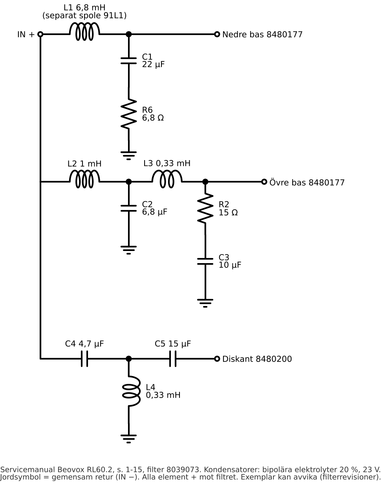
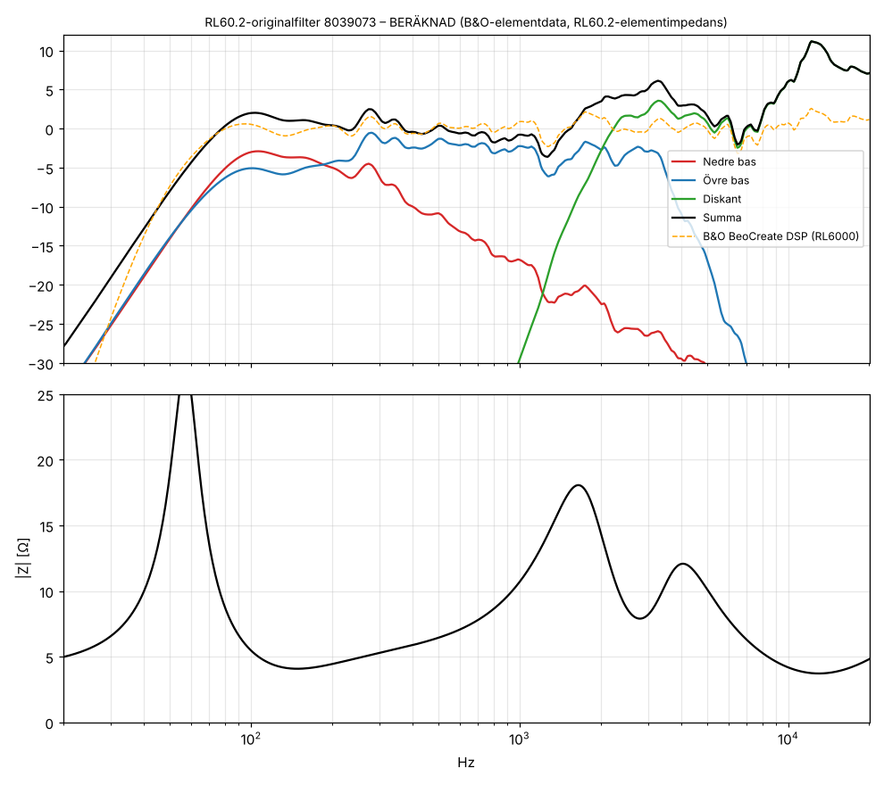

# Originalfiltren RL60.2 och RL6000 – analys och uppdaterad MkII-rekommendation

**RL6000 MkII · 2026-11-19**

**Märkning:**
- **[V]** verifierat i primärkälla
- **[H]** hypotes
- **[S]** simulerat (B&O:s elementdata + RL60.2-elementimpedans)
- **[F]** forum eller sekundärkälla.

Kan reproduceras med `cd sim && python3 originals.py`. Det ger figur 12–13, SPICE-netlistor i `sim/spice/` och tabellerna nedan. Schemat ritas av `python3 schematic_originals.py`.

---

## Sammanfattning

1. **RL60.2:s filterschema är nu verifierat** [V]. Det är en **2,5-vägare**:
    - Nedre basen har ett andra ordningens lågpass: 6,8 mH + 22 µF/6,8 Ω. Akustiskt ligger nedre basen 6 dB under den övre vid cirka 340 Hz.
    - Övre basen har ett tredje ordningens lågpass med impedanskompensering.
    - Diskanten har ett tredje ordningens högpass **utan nivåanpassning**.
2. **RL6000 är med stor sannolikhet också en 2,5-vägare med samma nedre basgren** [H, stark]. 6,8 mH-spolen och 22 µF-kondensatorn finns i båda komponentlistorna. Övre basens och diskantens värden är ändrade.
3. **RL6000:s kopplingsschema är ännu inte verifierat.** ManualsLib blockerar automatisk hämtning (HTTP 403, botskydd). Jag kringgår inte det. **En skärmdump eller PDF av sidan 9 från dig löser det.**
4. **Viktigt modellfynd** [S]: med B&O:s uppmätta element blir RL60.2-filtret +5 dB vid 2,5–3 kHz och +12 dB vid 12,5 kHz. Hi-Fi News mätte RL60.2 som i stort sett rak, ±3,8 dB. **B&O:s mätdata gäller alltså RL6000:s diskant, som är en annan och känsligare diskant än RL60.2:s.** Det förklarar varför B&O ändrade diskantsektionen till RL6000, och det stöder forumuppgiften om att filtret ändrades igen [F].
5. **Flera av mina tidigare argument för MkII faller:**
    - B&O hade redan 2,5-väg.
    - B&O:s nedre basgren gör samma sak som min.
    - Min delning på 450 Hz ligger nära B&O:s passiva lösning.
6. **Verkliga, dokumenterade förbättringsmöjligheter:**
    - **Kondensatorerna i originalet är bipolära elektrolyter med 20 % tolerans och 23 V märkspänning** [V]. Det ger upp till cirka **2,2 dB skillnad mellan vänster och höger** vid delningen kring 2,4 kHz [S, 95-percentil]. Med 5 % blir det 0,6 dB. Det påverkar stereobildens precision direkt och är billigt att åtgärda.
    - **Nedre basgrenen är fast och dimensionerad för fri placering.** Vid väggmontering ger den mer lägre bas och lägre mellanregister än behövs [S]. Det är troligen en del av förklaringen till ljudbilden du beskriver som "fyllig men platt".
    - Diskantens integration, fasföljd och topp vid 12,5 kHz går inte att bedöma för RL6000 förrän schemat finns. RL60.2 har ingen korrigering av toppen.
7. **Rekommendation:** en **originalbaserad hybrid**:
    - B&O:s nedre basgren behålls, med ett omkopplingsbart seriemotstånd för väggläge.
    - B&O:s övre basgren från RL6000 behålls om den visar sig bra.
    - Diskantsektionen byggs ny med närvaro- och nivåreglage, trap vid 13 kHz och polyfuse.
    - Allt med snäva, parade komponenter.

    Alternativet "helt nytt MkII" utgår som eget spår, eftersom det i praktiken redan är B&O:s topologi.

---

## A. Källäge

| Källa | Innehåll | Status |
|---|---|---|
| [Servicemanual Beovox RL60.2](https://retronik.silicium.org/DOCUMENTS/Audiovideo/Bang-Olufsen/Bang-Olufsen-Beovox-Rl-60.2-Service-Manual.pdf) (retronik.silicium.org) | Samlingsmanual för RL45, RL60.2 med flera. **RL60.2: s. 1-15** (PDF-sidan 9 högra halvan): filter **8039073**, schema och elektrisk komponentlista. **Teknisk data s. 1-14**: delning **3 500 Hz**, 2 × 13 cm, 1" diskant, 19 liter, 54 × 40,5 × 18 cm, 8,3 kg | [V] hämtad och avläst |
| Servicemanual Red Series (RL6000, typ 6522), [ManualsLib s. 9](https://www.manualslib.com/manual/4264493/Bang-And-Olufsen-Red-Series.html?page=9) | Enligt dig: 22 µF, 15 µF, 2 × 5,6 µF, 3,3 µF, spole 6,8 mH, filter **8039097**, plus fler spolar och motstånd | **Ej åtkomlig härifrån** (403). Värdena är dina avläsningar |
| [BeoWorld: "RL60.2 Refurb Collaboration"](https://archivedforum.beoworld.org/forums/p/40574/337521.aspx) | Se nedan | [F] hämtad och läst |

**Från BeoWorld-tråden** (sekundärkälla, sidan 7 av 17):
- RL60.2-filtret ändrades flera gånger under produktionen. Tidiga exemplar hade ett spånskivekort med allt kopplat i serie.
- Ett tidigt exemplar hade bas- och mellansektioner som stämde med servicemanualen, men diskantsektionen var "quite different". Spolarna saknade märkning.
- Filtret "was changed at least one more time with the RL6000".
- Servicemanualen ska ha haft "a couple typos and omissions".
- Inga scheman eller komponentlistor för RL6000 publicerades på den sidan. Övriga 16 sidor har jag inte gått igenom.

**Avvikelse:** du angav filter 8039093 för RL60.2. Manualen visar **8039073**, med kondensatorer som stämmer med din tabell: 22, 6,8, 10, 4,7 och 15 µF. Troligen en felläsning. Jämför med kortet.

**Viktigt:** din RL6000 kan ha en annan filterrevision än manualen. **Ditt fysiska kort är facit.**

## B. RL60.2, filter 8039073 – rekonstruerat schema [V]

| Gren | Komponenter (manualens beteckningar) | Koppling [V] | Tolkad funktion |
|---|---|---|---|
| Nedre bas (8480177) | **L1 6,8 mH** (separat spole, reservdel 91L1 6850186), **C1 22 µF** i serie med **R6 6,8 Ω** som shunt | L1 i serie. C1+R6 från elementets plus till jord | Andra ordningens lågpass, dämpat av R6. Ger baffle step-kompensation genom att nedre basen tonar ut runt 300–400 Hz |
| Övre bas (8480177) | **L2 1 mH**, **C2 6,8 µF** (shunt), **L3 0,33 mH**, **R2 15 Ω + C3 10 µF** över elementet | L2 – nod – C2 till jord. Nod – L3 – element. R2+C3 parallellt med elementet | Tredje ordningens lågpass (L–C–L). R2+C3 dämpar elementets stigande impedans och lågpassets resonans |
| Diskant (8480200) | **C4 4,7 µF**, **L4 0,33 mH** (shunt), **C5 15 µF** | C4 – nod – L4 till jord. Nod – C5 – diskant | Tredje ordningens högpass (C–L–C). **Ingen nivåanpassning eller skyddskomponent** |

Komponenttyper enligt komponentlistan [V]:
- Alla kondensatorer är bipolära elektrolyter med **20 % tolerans och 23 V**.
- R2 är 15 Ω, 10 %, 3 W. R6 är 6,8 Ω, 5 %, 3 W.
- "For replacing coils L2–L4, order complete crossover network": spolarna saknar egna reservdelsnummer.

SPICE: `sim/spice/rl602_8039073.cir`. Elementen är förenklade som Re + Le.

## C. RL6000 (typ 6522) – vad vi vet

| Komponent | RL60.2 [V] | RL6000 (dina uppgifter) | Tolkning |
|---|---|---|---|
| Spole nedre bas | 6,8 mH | 6,8 mH | Samma |
| C1 | 22 µF | 22 µF | Samma → **nedre basgrenen sannolikt identisk** [H, stark] |
| C2 | 6,8 µF | 15 µF | Ändrad. Kan betyda lägre lågpass för övre basen, eller en annan funktion |
| C3 | 10 µF | 5,6 µF | Ändrad |
| C4 | 4,7 µF | 3,3 µF | Ändrad. Mindre seriekondensator ger högre eller brantare högpass för diskanten |
| C5 | 15 µF | 5,6 µF | Ändrad |
| Övriga spolar och motstånd | L2 1 mH, L3 0,33 mH, L4 0,33 mH, R2 15 Ω, R6 6,8 Ω | "Finns angivna", okända värden | **Krävs för simulering.** Motstånd i diskantgrenen skulle förklara hur B&O dämpade den hetare RL6000-diskanten |
| Filternummer | 8039073 | 8039097 | Ny konstruktion |

**Slutsats:** RL6000 är en 2,5-vägare med B&O:s nedre basgren och en omkonstruerad övre bas- och diskantsektion. **Kopplingarna kan inte verifieras utan sidan 9 eller kortet.**

Jag har simulerat en *hypotes*: RL60.2-topologin med RL6000:s kondensatorer och RL60.2:s spolar. Den ingår i tabellen nedan men **ska inte användas för beslut**, eftersom kopplingar och spolvärden kan vara fel. Netlista: `sim/spice/rl6000_hypotes.cir`.

## D. Simulering: original mot MkII [S]

| | Nedre bas −6 dB under övre | W2/diskant-delning | Fasskillnad W2–diskant 1,8–3,5 kHz | Summa relativt 1 kHz: 3 kHz / 10 kHz / 12,5 kHz | Zmin <1 / >1 kHz | EPDR <1 / >1 kHz |
|---|---|---|---|---|---|---|
| RL60.2 original | 337 Hz | 2 015 Hz | +20…+70° | +5,9 / +6,8 / **+11,9 dB** | 4,08 / 3,72 Ω | 2,10 / 1,68 Ω |
| RL6000 hypotes | 333 Hz | 2 288 Hz | −89…−22° | +1,3 / +2,2 / +8,7 dB | 4,08 / 3,83 Ω | 2,07 / 1,93 Ω |
| MkII rev B | cirka 490 Hz | 2 849 Hz | +21…+59° | −3,9 / −3,2 / 0,0 dB | 4,45 / 3,85 Ω | 2,40 / 2,16 Ω |
| MkII B2 | (W2 rullar av tidigt) | 2 135 Hz | −22…+34° | −1,7 / −1,2 / +2,0 dB | 4,41 / 3,36 Ω | 2,46 / 1,79 Ω |

**Tolkning:**
- **Modellvalidering misslyckas för RL60.2:s diskant.** Simuleringen ger en mycket ljus högtalare, medan Hi-Fi News mätte en rak (±3,8 dB, notch vid 7 kHz). Det innebär att B&O:s elementdata **inte** gäller RL60.2:s diskant. Basdelen stämmer däremot: toppen vid 1,7–1,8 kHz före delningen finns både i modellen och i Hi-Fi News mätning.
- **RL6000-filtret är alltså anpassat till en annan diskant.** Den diskant B&O mätte är cirka 6 dB känsligare än baselementen. Utan schemat vet vi inte hur väl B&O kompenserade för det i det passiva RL6000-filtret.
- **Förstärkarlasten för originalet:** Zmin cirka 4,1 Ω och EPDR cirka 2,1 Ω i basområdet. Det överensstämmer med RL60.2:s uppmätta 4,75 Ω och 2,3 Ω (Hi-Fi News). Lasten ligger i samma klass som MkII-kandidaterna.
- **Väggmontering** (antagen modell, +5 dB under cirka 250 Hz): med B&O:s nedre basgren och B2 i övrigt blir basen relativt 1,5 kHz +9 dB vid 150 Hz. Med 10 Ω i serie blir det +5,8 dB. B2:s egen nedre basgren ger cirka 1,5 dB mindre vid samma seriemotstånd. Siffrorna är grova, eftersom referensen vid 1,5 kHz ligger i ett dippområde för B2. Riktningen är ändå entydig: **originalets nedre basgren behöver en kraftig vägganpassning för din placering.**

## E. Korrigerade tidigare slutsatser

| Tidigare | Nu | Konsekvens |
|---|---|---|
| "Originalet troligen en tvåvägare" (förstudien) | **RL60.2 verifierat 2,5-väg. RL6000 sannolikt likadan** | 2,5-väg är inget argument för MkII |
| 450 Hz för nedre basen "saknar motivering jämfört med B&O:s 801 Hz" | B&O:s **passiva** lösning ger nedre basen −6 dB vid cirka 340 Hz | Rev A:s 450 Hz var nära B&O:s passiva val. Behåll gärna B&O:s 6,8 mH-gren |
| "Delning cirka 3 500 Hz", preliminär uppgift | **Verifierat för RL60.2** (tekniska data). Den simulerade akustiska delningen W2/diskant är cirka 2 kHz med B&O-data | Den elektriska siffran är inte den akustiska delningen |
| B&O:s elementdata "för RL6000", tillämpade som om de gällde generellt | **Gäller inte RL60.2:s diskant** | RL60.2-schemat kan inte användas för att förutsäga RL6000:s ljud |
| "Lampa eller PTC i originalet" (förstudien, från foto) | **Inget skydd i RL60.2-schemat.** RL6000 okänt | Kontrollera på kortet |

## F. Uppdaterad bedömning av förbättringspotentialen

| Område | Begränsas av | Möjlig förbättring | Kostnad |
|---|---|---|---|
| **Stereoprecision och fokus** | Komponenter (20 %, 23 V, åldrade) | **Stor och sannolik:** parade komponenter med ±2–5 % [S]. Gäller även originalet | Låg |
| **Mellanbasens tydlighet och maskering vid vägg** | Fast nedre basgren dimensionerad för fri placering | **Sannolik:** S1-väggläge [S] | Låg |
| **Diskantens integration och fasföljd** | Filtret, okänt för RL6000 | **Okänd tills schemat finns.** B2 visar vad som går att nå [S] | Medel |
| **Topp vid 12,5 kHz** ("vasshet" eller "falsk detalj") | Diskantelementet. RL60.2 utan korrigering | **Sannolik** med fast trap, om RL6000 också saknar korrigering | Låg |
| **Närvaro och diskantkaraktär justerbart** | – | Ny funktionalitet | Medel |
| Diskantens dipp vid 6,5–7 kHz, spridning, distorsion, lådans resonanser | Element och låda | Ingen via filtret | – |
| Djup och rymd | Placering, rum, inspelning | Inåtvinkling, reflexer, frontduk | Låg |

**Bedömning:** potentialen ligger mer i **precision, vägganpassning och justerbarhet** än i ny topologi. Den enskilt säkraste vinsten för ljudbilden, nya parade komponenter, får även ett renoverat original. **Därför bör referensen (tillstånd B) renoveras med uppmätta och parade kondensatorer**, så att jämförelsen med MkII blir rättvis.

## G. Arkitekturval för rev B

| Alternativ | Bedömning |
|---|---|
| 1. Renoverat original (parade nya kondensatorer) | **Behålls som referens.** Troligen en tydlig förbättring mot dagens åldrade filter |
| 2. Originalbaserat MkII | Slås ihop med 4. Skillnaden försvinner när B&O:s basgrenar behålls |
| 3. Helt nytt MkII (rev A/B/B2) | **Utgår som eget spår.** B&O:s topologi är redan densamma. Lärdomarna (fasföljd, konstant-Z, närvaronotch, trap, polyfuse) flyttas till 4 |
| **4. Hybrid MkII** | **Rekommenderas** |

**Hybrid MkII rev B, innehåll:**
- **Nedre bas:** B&O:s topologi och värden (6,8 mH, 22 µF + 6,8 Ω), men med film eller snäva komponenter. **Plus S1:** seriemotstånd i steg 0 / cirka 3,3 / cirka 10 Ω (Fri / Neutral / Vägg), kopplat som tidigare så att avbrott aldrig kan uppstå. Vid väggmontering blir Vägg grundläget.
- **Övre bas:** B&O:s RL6000-gren enligt sidan 9, med nya komponenter. **Ändras bara om simuleringen visar dålig fasföljd mot den nya diskantsektionen.**
- **Diskant:** ny sektion enligt B2-principerna, med tredje ordningens högpass, **polyfuse**, **L-pad med konstant impedans (S3)**, **shuntnotch för närvaro (S2)** och **fast trap vid cirka 13 kHz**. Värdena räknas mot RL6000:s originalgren och mot B&O:s diskantdata, som ju gäller just RL6000:s diskant.
- **Princip:** reglagen får inte flytta delningspunkten. Neutralläget ska vara rakt.

**Kostnad:** färre nya spolar, eftersom två grenar följer B&O:s värden. Uppskattningsvis 1 100–1 700 kr för paret, ej verifierat.

## H. Praktisk väg framåt – vad jag behöver

| # | Vad | Varför | Insats |
|---|---|---|---|
| 1 | **Skärmdump eller PDF av ManualsLib s. 9** (RL6000-schemat och komponentlistan, gärna även intilliggande sidor), i bästa möjliga upplösning | Verifierar RL6000:s topologi och de okända spol- och motståndsvärdena. **Blockerar allt annat** | 5 min |
| 2 | **Foto av ditt filterkort** (komponentsidan, skarpt och rakt uppifrån) och märkningen på kondensatorer och motstånd | Avgör filterrevisionen. Ditt kort är facit | 15 min (öppna en högtalare) |
| 3 | **Reservdelsnummer på diskanten** (etiketten bak) och på basarna | Bekräftar att B&O:s mätdata gäller dina element | Samtidigt som 2 |
| 4 | Re (multimeter) för de tre elementen | Elementmodellen | Samtidigt som 2 |
| 5 | Mått och vinklar för elementen på fronten, och hur högtalarna sitter på väggen (från förra leveransen) | Lobing och ljudbild | 10 min |
| 6 | (Senare) impedanskurva | Slutliga värden | 1 h |

**Det jag gör så snart punkt 1 finns:** rita RL6000-schemat, simulera originalet med B&O:s data (detta blir den riktiga referensen), dimensionera hybriden och ta fram komponentlista med artikelnummer.
